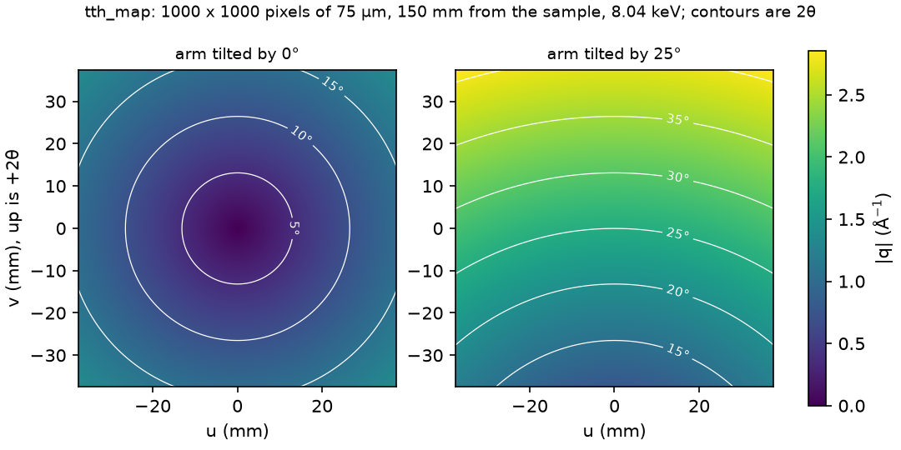

# QoraGeom

[](https://github.com/NaNIsaac/QoraGeom/actions/workflows/ci.yml) [](LICENSE)

X-ray diffraction geometry, SPEC parsing and detector-frame loaders for Python.



Per-pixel 2θ and |q| from `tth_map` at arm tilts of 0° and 25° ([reproduce the figure](docs/media/README.md)).

<!-- overview:start -->
Full documentation: [QoraGeom](https://nanisaac.github.io/docs/qorageom/).

QoraGeom converts photon energy, wavelength, 2θ, |q| and d-spacing, computes per-pixel detector
geometry and builds BCDI reciprocal-space bases. Version 0.1.0 also includes legacy SPEC parsing
and optional MAT, TIFF and HDF5 loaders. It does not reconstruct diffraction data;
phase retrieval is [QoraPhase](https://github.com/NaNIsaac/QoraPhase).

Start with [installation](docs/install.md) and the [tutorial](docs/tutorial.md).
Continue with [geometry examples](docs/guides/geometry-and-io.md),
[SPEC and frame readers](docs/guides/file-readers.md), [BCDI pipeline](docs/guides/pipelines.md), or the [project boundary](docs/guides/boundary.md).
The documentation hub generates the Python API from the package docstrings.

See the [changelog](https://github.com/NaNIsaac/QoraGeom/blob/main/CHANGELOG.md),
[citation](https://github.com/NaNIsaac/QoraGeom/blob/main/CITATION.cff) and
[figure reproduction](docs/media/README.md).
<!-- overview:end -->

## Install

Requires Python 3.13 or later. [QoraGeom 0.1.0 is on PyPI](https://pypi.org/project/qorageom/).
Create a small uv project and install it:

<!-- test -->
```sh
uv init --no-workspace --python 3.13 qorageom-demo
uv add --directory qorageom-demo qorageom
```

For optional HDF5, TIFF and pandas support, see [installation](docs/install.md).

## Quick start

Run this from the directory where you created `qorageom-demo`:

<!-- test console -->
```console
$ uv run -q --directory qorageom-demo python -c "from qorageom import wavelength, tth_to_q; lam = wavelength(8.04); print('wavelength: %.5f angstrom' % lam); print('q: %.5f inverse angstrom' % tth_to_q(30, lam))"
wavelength: 1.54209 angstrom
q: 2.10909 inverse angstrom
```

The input is 8.04 keV and 2θ = 30°. QoraGeom computes geometry; it does not perform phase retrieval.

## Documentation

- [Overview](docs/index.md), [installation](docs/install.md) and [tutorial](docs/tutorial.md).
- [Geometry examples](docs/guides/geometry-and-io.md): reciprocal bases, resampling and strain.
- [SPEC and detector-frame readers](docs/guides/file-readers.md) and [BCDI pipeline](docs/guides/pipelines.md).
- [Current and intended boundaries](docs/guides/boundary.md): legacy file readers still exist in 0.1.0.
- API reference is generated by the [documentation hub](https://nanisaac.github.io/docs/) from package docstrings when the project is registered there.
- [Changelog](CHANGELOG.md) and [citation](CITATION.cff).

## License

MIT, see [LICENSE](LICENSE).
